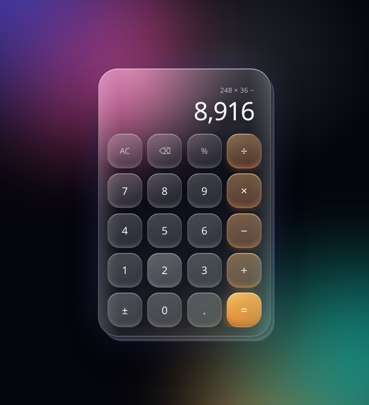

# Glass Calculator

A calculator with Samsung's One UI keypad layout and Apple-style glass materials — a frosted slab with a cut side wall and keys that sit in the glass.



## Run it

Open `index.html`. No build, no install, no dependencies.

Or serve it:

```bash
python3 -m http.server 8000
```

## What it does

- **One UI key order:** `AC ⌫ % ÷` on top, `± 0 . =` on the bottom row
- **Correct precedence:** `2 + 3 × 4` is 14, not 20
- **Live preview:** the lower line shows the running result as you type
- **Typed digits are kept:** your input appears exactly as entered, with grouping added for reading
- **Floating point that makes sense:** `0.1 + 0.2` reads `0.3`
- **Keyboard support:** digits, `+ - * /`, `Enter` to evaluate, `Backspace`, `Esc` to clear
- **Divide by zero** shows `Error` and locks the pad until `AC`

## Glass without images

Everything is CSS: a backdrop-filtered slab, a light pool behind it for the glass to refract, and four offset shadows stacked to draw the slab's side wall. Keys brighten under the cursor and press inward on tap.

Respects `prefers-reduced-motion`, and every key is a real `<button>` with an accessible label.

## Test

```bash
node test.js
```

## Files

| File | Purpose |
| --- | --- |
| `index.html` | Markup and keypad |
| `style.css` | Glass materials and layout |
| `calc.js` | Expression evaluation and formatting |
| `app.js` | Keypad state and input handling |
